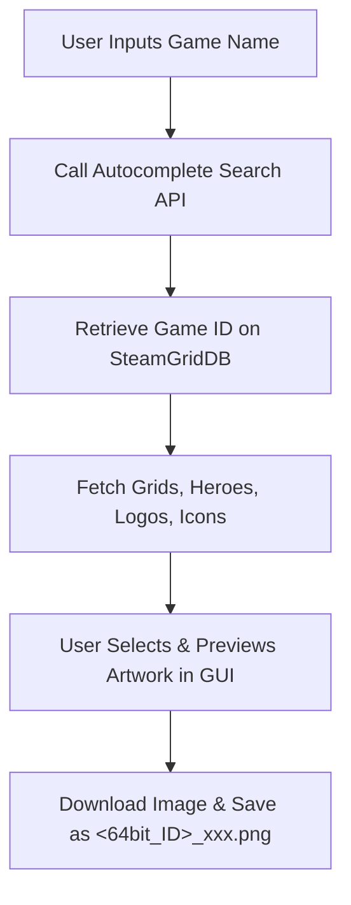

# Guide: Programmatic Integration of Non-Steam Games & Artwork

This guide provides technical specifications and code examples for programmatically adding non-Steam applications to Steam and matching them with high-quality custom artwork. This information is designed to help you construct a custom GUI utility (e.g., using Python/PyQt or Node.js/Electron/Tauri) for SteamOS and desktop clients.

---

## 1. Locating and Modifying `shortcuts.vdf`

Steam manages all non-Steam shortcuts in a binary file named `shortcuts.vdf`. 

### File Location
The file is located in the user-specific configuration directory:
*   **Linux / SteamOS / Steam Deck:** `~/.steam/root/userdata/<UserID>/config/shortcuts.vdf` (or `~/.local/share/Steam/userdata/<UserID>/config/shortcuts.vdf`)
*   **Windows:** `C:\Program Files (x86)\Steam\userdata\<UserID>\config\shortcuts.vdf`
*   **macOS:** `~/Library/Application Support/Steam/userdata/<UserID>/config/shortcuts.vdf`

> [!IMPORTANT]
> **Steam Client Synchronization:**
> The Steam client reads `shortcuts.vdf` into memory on startup and writes it back when exiting or when a user modifies shortcuts via the UI. If you modify `shortcuts.vdf` while Steam is running, Steam will overwrite your changes when it closes.
> **You must shut down the Steam client before programmatically editing `shortcuts.vdf`.**

---

## 2. Binary Structure of `shortcuts.vdf`

`shortcuts.vdf` is serialized in Valve's binary KeyValues format. Rather than parsing it with regex or raw binary splits, it is best to use a binary VDF parser library:
*   **Python:** `vdf` (available via `pip install vdf`)
*   **Node.js / TypeScript:** `steam-binary-vdf` (available via `npm install steam-binary-vdf`)

### Layout Details
The binary format uses type prefixes before keys and values:
*   `0x00` - Marks the start of a nested dictionary (object).
*   `0x01` - Marks a null-terminated UTF-8 string.
*   `0x02` - Marks a 32-bit little-endian integer.
*   `0x08` - Marks the end of a dictionary.

### Core Shortcut Object Fields
When adding an entry to the `shortcuts` dictionary (which is indexed as `"0"`, `"1"`, `"2"`, etc.), you should populate the following fields:

| Field Name | Type | Description |
| :--- | :--- | :--- |
| `appid` | Int32 | The 32-bit AppID generated by Steam (details below). |
| `AppName` | String | The display name of the shortcut in the library. |
| `exe` | String | The path to the executable, wrapped in quotes (e.g., `"/usr/bin/flatpak"`). |
| `StartDir` | String | The working directory path, wrapped in quotes (e.g., `"/usr/bin/"`). |
| `icon` | String | Path to a custom `.png`, `.ico`, or `.exe` file for the library icon. |
| `LaunchOptions` | String | Launch parameters (e.g., `run --branch=stable org.dolphinemu.dolphin`). |
| `IsShortcut` | Int32 | Boolean flag (`1` for true). |
| `AllowDesktopConfig`| Int32 | Boolean flag (`1` for true). |
| `AllowOverlay` | Int32 | Boolean flag (`1` for true). |
| `OpenVR` | Int32 | Boolean flag (`0` for false, `1` for VR games). |
| `Devkit` | Int32 | Devkit flag (`0` for false). |
| `tags` | Dict | A nested dictionary of user-defined tags (indexed `"0"`, `"1"`, etc.). |

---

## 3. AppID and Launch ID Mathematics

To apply custom artwork or create protocol launch links (`steam://rungameid/<id>`), you must calculate the game's **32-bit AppID** and **64-bit Launch ID** (also called the Shortcut ID).

### The Math
1.  **32-bit AppID:** Calculated as the CRC32 checksum of the concatenated `exe` and `AppName` strings as they are stored in `shortcuts.vdf`, bitwise OR'd with `0x80000000` (setting the top bit high).
2.  **64-bit Launch ID / Artwork Filename ID:** Calculated by shifting the 32-bit AppID left by 32 bits, and bitwise OR'ing it with the constant `0x02000000` (which is `33554432` in decimal).

$$\text{LaunchID}_{64} = (\text{AppID}_{32} \ll 32) \mid \text{0x02000000}$$

> [!WARNING]
> The concatenation string must match the exact bytes stored in `shortcuts.vdf`. If the path is wrapped in quotes in the file, those quotes **must** be present in the string fed into the CRC32 function (e.g., `"/usr/bin/flatpak"Dolphin Emulator`).

### Python Implementation Example
```python
import binascii

def calculate_shortcut_ids(exe_path: str, app_name: str):
    # Match the formatting in shortcuts.vdf (usually wrapped in double quotes)
    formatted_exe = f'"{exe_path}"' if not exe_path.startswith('"') else exe_path
    
    # Concatenate executable path and app name
    combined_string = formatted_exe + app_name
    
    # Calculate CRC32 checksum (IEEE 802.3 standard)
    crc = binascii.crc32(combined_string.encode('utf-8')) & 0xffffffff
    
    # Short 32-bit AppID (Top bit set high)
    short_appid = crc | 0x80000000
    
    # Long 64-bit Launch ID / Artwork ID
    long_appid = (short_appid << 32) | 0x02000000
    
    return short_appid, long_appid

# Example Usage:
exe = "/usr/bin/flatpak"
name = "dolphin-emu"
short_id, long_id = calculate_shortcut_ids(exe, name)

print(f"Concatenated String: {exe}{name}")
print(f"32-bit AppID (signed int): {int(short_id - 2**32) if short_id > 2**31 - 1 else short_id}")
print(f"32-bit AppID (unsigned hex): {hex(short_id)}")
print(f"64-bit Artwork ID (decimal): {long_id}")
# Output long_id: 9627061802655285248
```

---

## 4. Custom Artwork Specifications & Naming Conventions

Steam stores custom artwork locally in `userdata/<UserID>/config/grid/`.
To override library images, you must download the images and save them into this directory using the **64-bit Launch ID** as the filename.

### Artwork Types and Dimensions

| Placement | Filename Format | Recommended Resolution | Aspect Ratio | Format |
| :--- | :--- | :--- | :--- | :--- |
| **Grid Cover (Portrait)** | `[LaunchID]p.png` | 600 × 900 px | 2:3 | PNG or JPG |
| **Hero (Banner/Background)**| `[LaunchID]_hero.png` | 1920 × 620 px / 3840 × 1240 px | ~3.1:1 | PNG or JPG |
| **Logo** | `[LaunchID]_logo.png` | Variable (Transparent background) | Custom | PNG (Transparent) |
| **Grid Cover (Landscape)**  | `[LaunchID].png` | 920 × 430 px / 460 × 215 px | ~2.1:1 | PNG or JPG |
| **Icon** | `[LaunchID]_icon.png` | 32 × 32 px / 48 × 48 px | 1:1 | PNG or ICO |

---

## 5. Fetching Artwork from SteamGridDB

[SteamGridDB](https://www.steamgriddb.com/) is the primary API used by community launchers (like BoilR or Decky Loader) to fetch game artwork.

### API Credentials
Register an account on SteamGridDB and generate an API Key in your Developer Preferences.

### API Authorization Header
All API requests must contain:
```http
Authorization: Bearer <YOUR_API_KEY>
```

### Search Flow



#### Step 1: Resolve Game Name to SteamGridDB ID
Use the autocomplete search endpoint to look up the game:
*   **Endpoint:** `GET https://www.steamgriddb.com/api/v2/search/autocomplete/{query}`
*   **Sample Response:**
    ```json
    {
      "success": true,
      "data": [
        {
          "id": 1904,
          "name": "Dolphin Emulator",
          "release_date": 1064188800,
          "types": ["software"]
        }
      ]
    }
    ```

#### Step 2: Fetch Artwork Items
Using the `id` (e.g., `1904`), query the specific endpoints to list available graphics:

*   **Grids (Portrait):** `GET https://www.steamgriddb.com/api/v2/grids/game/1904?dimensions=600x900`
*   **Heroes (Banners):** `GET https://www.steamgriddb.com/api/v2/heroes/game/1904`
*   **Logos:** `GET https://www.steamgriddb.com/api/v2/logos/game/1904`
*   **Icons:** `GET https://www.steamgriddb.com/api/v2/icons/game/1904`

Parse the JSON response and display the image previews (found in the `thumb` or `url` fields) in your GUI.

---

## 6. GUI Application Architecture Guide

To build a sleek GUI tool for Steam Deck or desktop users, structure your application into a front-end view and a back-end controller.

```
+-------------------------------------------------------------+
|                     SteamOS Artwork GUI                     |
+-------------------------------------------------------------+
|                                                             |
|  Select Program: [ /usr/bin/dolphin-emu              ] [..] |
|  Display Name:   [ Dolphin Emulator                  ]      |
|                                                             |
|  +-------------------------------------------------------+  |
|  | SteamGridDB Artwork Search Results                    |  |
|  |                                                       |  |
|  |  [ Portrait Grid ]    [ Hero Banner ]    [ Logo ]     |  |
|  |  +--------------+     +-------------+    +----+       |  |
|  |  |              |     |             |    |    |       |  |
|  |  |  (Image)     |     |  (Image)    |    |    |       |  |
|  |  |              |     |             |    +----+       |  |
|  |  +--------------+     +-------------+                 |  |
|  |   Change...            Change...          Change...   |  |
|  +-------------------------------------------------------+  |
|                                                             |
|                            [ ADD TO STEAM & APPLY ARTWORK ] |
+-------------------------------------------------------------+
```

### Process Sequence for GUI Application
1.  **Select App:** User selects a program file using a system open-file dialog. The GUI auto-fills the `AppName` based on the binary name.
2.  **Verify Steam State:** The backend checks if Steam is running. If yes, it alerts the user to close Steam (or handles client termination automatically).
3.  **Compute IDs:** The backend calculates the 32-bit and 64-bit AppIDs.
4.  **Fetch Suggestions:** The front-end queries SteamGridDB's autocomplete API for search suggestions and lists matches in a dropdown/grid.
5.  **Fetch Options:** When the user selects a match, the front-end fetches the grid, hero, logo, and icon URLs. It renders them in a grid preview.
6.  **Download Assets:** Once the user clicks "Add to Steam", the backend downloads the selected images to:
    `userdata/<UserID>/config/grid/<LaunchID>p.png` (Portrait Cover)
    `userdata/<UserID>/config/grid/<LaunchID>_hero.png` (Banner Background)
    `userdata/<UserID>/config/grid/<LaunchID>_logo.png` (Title Logo)
7.  **Write VDF Entry:** The backend opens `shortcuts.vdf`, deserializes it, appends the new shortcut dictionary containing the calculated `appid`, serializes it back, and saves the file.
8.  **Launch Steam:** The application notifies the user of success and offers to start Steam.
